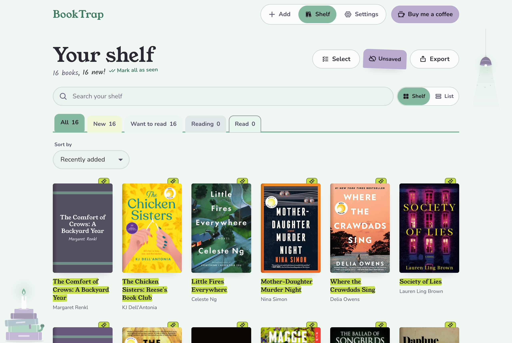
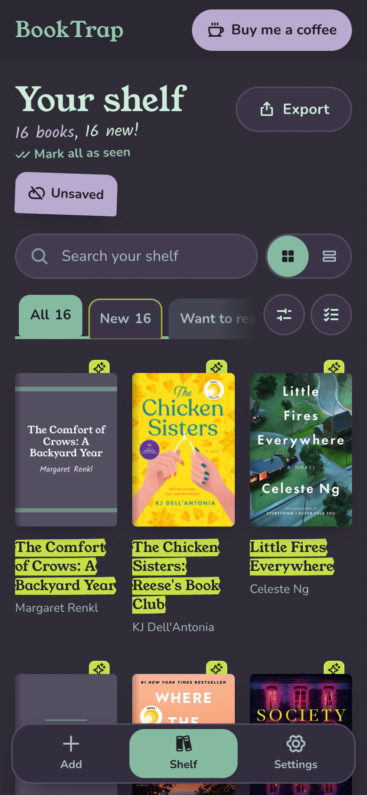
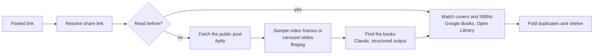

# BookTrap

**Paste a TikTok or Instagram link, get every book in it on your shelf.** BookTrap watches the post the way a reader would (the covers held up to the camera, the spines on the shelf behind, the caption, the on-screen text and what's said out loud) and turns it into a want-to-read list you can export to Goodreads.

**Live at [booktrap.app](https://booktrap.app)** · free, no account needed to try it

<p>
  
  
</p>

## What it does

- **Any BookTok or Bookstagram post:** videos, photo carousels, reels and share links, several at once, or a whole public TikTok collection.
- **Finds the books, not the clutter:** Claude reads the frames, caption, hashtags and subtitles, and keeps the books the post is actually about (a shelf in the background doesn't count).
- **Real covers and ISBNs** from Google Books and Open Library, and one row per book: the same book from two posts becomes one entry with both sources.
- **A shelf you can work with:** want to read, reading and read; your own shelves; notes; search, sort and a list view; undo.
- **Take it anywhere:** Goodreads CSV (imports into Goodreads and Fable), PDF with covers, CSV, JSON or plain text.
- **No sign-up to start:** a guest shelf works straight away; saving it with an email (a code or a password) keeps it on every device.
- **Safe to share:** an invisible bot check, daily limits, a content check that skips explicit posts, and report and takedown tools for readers and creators.

## How it works



Each post is read once and cached (90 days), so a post a hundred people paste costs the same as one. Videos are never stored: frames are sampled into a temporary folder and deleted. A fair queue gives every reader a turn, and a monthly budget and spend kill switch keep the bill bounded.

## Built with

| Part | Stack |
|---|---|
| Web app (`web/`) | React 19, Vite, TypeScript, Tailwind CSS v4, TanStack Query, React Router; an installable PWA with light and dark themes |
| API (`api/`) | Node 24, Fastify, TypeScript, Zod, ffmpeg |
| Reading posts | Apify scrapers, Anthropic Claude (vision and structured output) |
| Data and sign-in | Supabase (Postgres with row-level security, anonymous and email auth) |
| Hosting | Render (API), Cloudflare Pages, DNS, Turnstile and Email Routing, Resend (email) |
| Quality | Vitest (about 300 tests), ESLint, GitHub Actions CI, Playwright checks, load-tested with Docker at production limits |

Some engineering notes:
- **The browser never touches the database.** Every table has row-level security with no policies; only the API's server key can read data, and every query is scoped to the signed-in user, whose token the API checks against Supabase's published signing keys.
- **Guests become accounts without losing anything.** A guest is an anonymous Supabase user; saving the shelf adds an email to the same user, and logging in from a guest browser merges the guest's books into the account, folding duplicates.
- **Costs are measured, not guessed.** Every paid call is recorded; a 100-reader load test sized the server; the [cost report](BookTrap-cost-report.pdf) projects spend at 100, 1,000 and 10,000 readers.
- **Privacy by default.** No ads, analytics or tracking cookies; network addresses are kept only as keyed hashes for 2 days; a strict Content-Security-Policy; readers delete their account and everything in it from Settings.

## Repository layout

| Path | What it is |
|---|---|
| `web/` | The web app. Deploys to Cloudflare Pages. |
| `api/` | The API. Holds every third-party key. Deploys to Render (`render.yaml`). |
| `shared/` | Zod schemas, limits and export formats used by both. |
| `supabase/migrations/` | The Postgres schema, in order. |
| `supabase/templates/` | The sign-in email templates. |
| `BUILD_BRIEF_BookCatcher.md`, `PROGRESS.md` | The product brief (working name "BookCatcher") and the build log, phase by phase, with every decision. |

## Run it locally

Requires Node 22.12+ (`.nvmrc` pins 24).

```sh
npm install
cp api/.env.example api/.env    # keys for Supabase, Apify, Anthropic, Google Books
cp web/.env.example web/.env
npm run dev                     # API on :8787, web on :5180
npm run check                   # lint, typecheck, tests and build (what CI runs)
```

With `SUPABASE_URL` empty, the API keeps everything in memory (wiped on restart), which is enough for UI work. For real data, create a Supabase project, run every file in `supabase/migrations/` in order in the SQL editor, put the project URL and **secret** key in `api/.env`, and the URL and **publishable** key in `web/.env`. `GET http://localhost:8787/health` then reports `"storage":"supabase"`. Reading posts needs `APIFY_TOKEN` and `ANTHROPIC_API_KEY`.

## Support

BookTrap is free. If it found you a good book, you can [buy me a coffee on Ko-fi](https://ko-fi.com/zalhashemi): it helps pay for reading posts and hosting.

---

The sections below are the operator's notes: how the moving parts fit together, and how to run and deploy BookTrap.

## How accounts work

Every visitor is a Supabase Auth user. A first visit signs in anonymously, which makes a **guest** (5 posts a day). Saving the shelf adds an email, with a password or an email code, to that same user, so the shelf stays as it is (40 posts a day). The web app uses supabase-js for sign-in only and sends the access token as `Authorization: Bearer` on every request. The API checks it locally against the project's published ES256 signing keys (`api/src/auth/session-auth.ts`), and every query is scoped to that user. The browser never reads the database: RLS is on with no policies.

Logging in on a browser that has a guest shelf merges the guest's books into the account (`POST /v1/account/merge-guest`, with the guest's token in the body), then deletes the guest. Guests nobody has visited for 30 days are deleted by the API's 6-hourly purge.

## Exports

All five exports are built in the browser from the shelf the app already has (`shared/src/export.ts` holds every column). The PDF is drawn with `@react-pdf/renderer`, which loads only when someone asks for a PDF. Google Books cover images can't be read by a browser (no CORS headers), so the API passes a book's own stored cover through `GET /v1/books/:id/cover`. That route needs the owner's sign-in, fetches only from the Google Books and Open Library hosts, accepts only images, and caps them at 2 MB.

To bring the list into Goodreads, download the Goodreads CSV and upload it at goodreads.com/review/import. Fable's beta import (fable.co/goodreads-import) takes the same file.

## Environment

All API configuration is in `api/.env.example`. The web app reads only public values (`web/.env.example`): the API URL, the Supabase URL and publishable key, and the Turnstile site key. **Never put a secret key in `web/.env`**: anything prefixed `VITE_` ships to every visitor. CI fails the build if a known key pattern shows up in `web/dist`.

## Privacy and removal requests

The privacy policy and terms are at `/privacy` and `/terms` (`web/src/routes/LegalPages.tsx`, which also holds the operator name, contact address and the retention periods it promises). They're drafts for a lawyer to check before BookTrap charges money.

Readers delete their own account (or guest shelf) in Settings, Your data (`DELETE /v1/account`). Other requests arrive at the contact address:

- **A reader asking about their data**: find them by email under Authentication, Users in the Supabase dashboard. Their user id owns their rows (`books.user_id` and so on).
- **A creator asking for removal** (promised within 14 days): open `/admin` in the web app, enter the admin key (`ADMIN_TOKEN` in the API's environment), and paste each post's link under "Take down a link". Or from `api/`: `npx tsx --env-file=.env scripts/takedown.ts <post link>` (`--dry-run` first shows how far it reached). A taken-down post leaves every shelf and is never read again, whoever pastes it. Books seen only in it are deleted, unless a reader changed them (status, notes or shelves): those stay without the source. For a whole handle, find its posts first: `select distinct source_platform, source_post_id, source_url from book_sources where creator_handle = '<handle>';`.
- **Stats**: the Stats tab on `/admin` shows readers, posts read per day (paid against free cache hits), this month's spend against the budget with a forecast, failures, the most-shelved books and the database size. Counts only, never a reader's shelf. Needs migration 0012.
- **Reports** from readers ("Report this post" in a book's sources) wait under Open on `/admin`, grouped by post, with how many shelves each post is on. Take down or Dismiss. The Auto-blocked tab lists posts the content check skipped (explicit or graphic, not books, or that Claude declined); Unblock marks a wrong verdict as a book post, and the next paste shelves its books without reading it again.

## Deploy

Four services: **Supabase** (database and sign-in), **Render** (the API, `render.yaml`, Starter plan), **Cloudflare** (the domain `booktrap.app`, Pages for the web app, Turnstile, email forwarding) and **Resend** (sign-in emails). After setup, a push to `main` runs CI; Render deploys only once CI is green.

1. **Domain** (Cloudflare Registrar): `booktrap.app`. The site is `https://booktrap.app` and the API is `https://api.booktrap.app`.
2. **Supabase**:
   - Run every file in `supabase/migrations/` in order (0001 to 0012).
   - Authentication, URL Configuration: Site URL `https://booktrap.app`; redirect URLs `https://booktrap.app/**` (keep `http://localhost:5180/**` for development).
   - Authentication, Emails: paste `supabase/templates/magic-link.html` into **Magic Link** (subject "Your BookTrap log-in code") and `email-change.html` into **Change Email Address** (subject "Save your BookTrap shelf"). Both need `{{ .Token }}`: the app asks for the code. The log-in email is code only on purpose: signing in from a link would skip moving a guest shelf into the account, and mail scanners that open links would use up the code.
   - Authentication, Emails, SMTP: host `smtp.resend.com`, port 465, user `resend`, password a Resend API key (sending access, this domain only), sender `hello@booktrap.app`, name `BookTrap`.
   - Authentication, Attack Protection: turn on CAPTCHA with the provider set to **Turnstile** (it defaults to hCaptcha, which rejects every Turnstile token) and the Turnstile **secret** key. Do this last, once the site has `VITE_TURNSTILE_SITE_KEY`: until then every sign-in fails.
3. **Resend**: add the domain `booktrap.app` with sending only (receiving off: Cloudflare Email Routing receives mail) and copy its records into Cloudflare DNS: the DKIM TXT `resend._domainkey` and the CNAMEs `send` and `rsend`, both **DNS only** (proxied CNAMEs can't verify). One DMARC record, `_dmarc` TXT `v=DMARC1; p=none;` (tighten to `p=quarantine` once mail is flowing). Wait for "Verified".
4. **Cloudflare**:
   - Email Routing: forward `hello@booktrap.app` to the operator's inbox (the policies show this address).
   - Turnstile: a widget for `booktrap.app` and `localhost`, mode **Managed** (with `interaction-only`, most visitors see nothing; a browser Turnstile is unsure of gets a checkbox instead of a dead end). The site key goes to Pages (`VITE_TURNSTILE_SITE_KEY`) and `web/.env`; the secret goes to Supabase only.
5. **Render** (API): New, Blueprint, pick this repo (a resumed service keeps its old build: use Manual Deploy, Deploy latest commit). Render reads `render.yaml` and asks for the secrets: `SUPABASE_URL`, `SUPABASE_SERVICE_ROLE_KEY`, `APIFY_TOKEN`, `ANTHROPIC_API_KEY`, `GOOGLE_BOOKS_API_KEY` and `ALLOWED_ORIGIN` (`https://booktrap.app`). `IP_HASH_KEY` and `ADMIN_TOKEN` (the key for `/admin`) are generated. `region` matches the Supabase project (Singapore) and can't be changed later. Settings, Custom Domains: add `api.booktrap.app`, then in Cloudflare DNS a CNAME `api` to the `onrender.com` address, **DNS only** (grey cloud), so requests reach Render directly and the client IP chain stays Render's (the API trusts exactly 3 proxy hops, measured: proxying the record adds a fourth). When it's live, `https://api.booktrap.app/health/ready` answers `{"ok":true}`.
6. **Cloudflare Pages** (web): Workers & Pages, Create, Pages, connect this repo.
   - Build command: `npm run build -w @booktrap/web` (Pages installs dependencies itself). Build output directory: `web/dist`.
   - Environment variables (all public; they ship in the bundle): `VITE_API_URL=https://api.booktrap.app`, `VITE_SUPABASE_URL`, `VITE_SUPABASE_PUBLISHABLE_KEY`, `VITE_TURNSTILE_SITE_KEY`.
   - Custom domains: add `booktrap.app`. Turn off Web Analytics for the project (the policies promise no analytics, and the CSP blocks its script anyway).
   - A changed variable needs a new build. "Retry deployment" rebuilds that deployment's own commit, so retry the latest one.
   - Node comes from `.nvmrc`. Unknown paths fall back to `index.html`, so `/shelf` and `/privacy` load directly. The build writes `web/dist/_headers`: a Content-Security-Policy naming the API, Supabase and Turnstile, `nosniff`, `frame-ancestors 'none'` and long caching for hashed assets. Preview deployments have their own address, which `ALLOWED_ORIGIN` doesn't list, so they can't reach the API.
7. Check: open `https://booktrap.app`, paste a link, see it shelved, then save the shelf with an email and log in on another browser with the emailed code.
